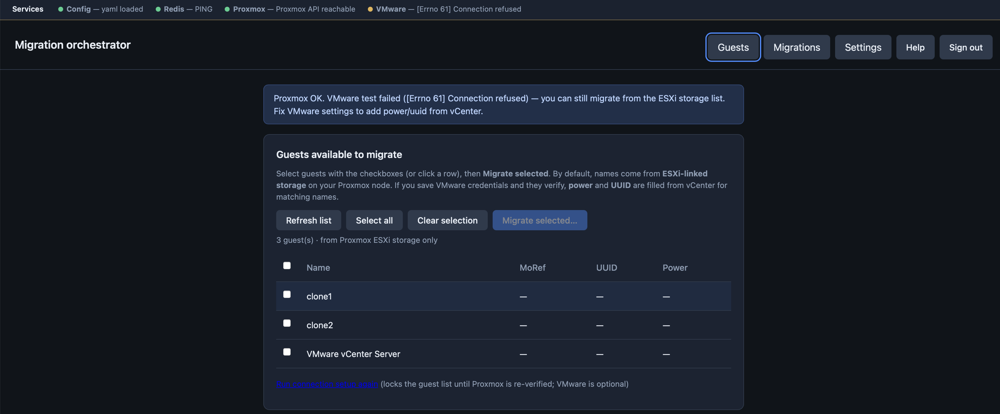

# Migration Engine

VMware → Proxmox migration orchestrator (**v2.2.0**): FastAPI dashboard and API plus a Redis-backed **worker** that runs the migration pipeline — disk import directly to the SCSI boot disk, then first-boot guest-agent checks.

## Intended use

Supports **Windows 11**, **Windows Server**, and **Linux** guests equally. Match firmware to the source (UEFI or SeaBIOS); **vTPM** is attached by default only for UEFI + Windows (opt in for other cases). Forcing UEFI on a legacy-BIOS guest will not boot — prefer **importer-resolved** firmware from Proxmox VMX `import-metadata`, or override per VM in the Migrate dialog.

## Features (v2.2)

- **Real ESXi → Proxmox import** via PVE `import-from` / linked ESXi storage (`auto-esxi` or path templates). Simulated template-clone import was removed.
- **Firmware & guest profile from import-metadata** — the Migrate dialog can use Proxmox VMX `import-metadata` (BIOS type, guest hints, memory/cores) per VM, or **override** firmware/profile/vTPM in a per-VM matrix.
- **Per-VM resources** — RAM (MiB), vCPUs, and optional VLAN are set in the migrate matrix (defaults fall back to import-metadata, then `config.yaml`). Shared batch-only RAM/CPU/VLAN fields were removed from the UI.
- **vTPM policy** — attached by default for UEFI + Windows; SeaBIOS and Linux skip vTPM unless you opt in. SeaBIOS guests do not get `efi-redo-pending` post-migrate tags.
- **Snapshot safety** — refuses import when the source folder still has VMware snapshot deltas (stale base VMDK).
- **Operator feedback** — Migrate opens with an immediate busy state and loading banner while defaults/metadata load; enqueue shows progress while jobs are submitted.
- **No WinRM / Horizon** — guest automation hooks and `pywinrm` were removed; the pipeline ends after guest-agent checks (post-migrate tags applied).
- **Parallel imports** — Redis permit pools per ESXi storage bucket (see below).
- **CPU presets** — keep imported CPU by default, or apply advanced `args=` presets (root helper required).

## Screenshot



## What you need

- **Python** 3.10+ (3.11+ recommended)
- **Redis** (job state, logs, queue, ESXi import permit pools)
- **config.yaml** at the default path or pointed to by **`MIGRATION_ENGINE_CONFIG`**
- Network reachability from the API host and the worker to **Proxmox** and (if used) **vCenter**

`config.yaml` is validated at startup (API, worker, and dashboard credential loads). Invalid or incomplete config fails fast with a clear error instead of dying mid-migration.

## Quick start (development)

```bash
cd migration-engine
python3 -m venv .venv
source .venv/bin/activate   # Windows: .venv\Scripts\activate
pip install -r requirements.txt -r requirements-dev.txt
cp config.docker.example.yaml config.yaml   # or start from your own file
# Edit config.yaml: ui.password, ui.session_secret (>=16 chars), redis.url, proxmox.*, etc.

# Terminal 1 - API + static UI (adjust host/port as needed)
uvicorn main:app --host 0.0.0.0 --port 8000

# Terminal 2 - worker (one process; scale with multiple terminals or containers)
python worker.py
```

Open **http://127.0.0.1:8000/** and sign in with `ui.password`. The footer shows **version** (and optional **build** id from `MIGRATION_ENGINE_GIT_REVISION`). Public JSON: `GET /version`, `GET /health`.

## Docker

See **[DOCKER.md](DOCKER.md)** for Compose (Redis + API + worker). Scale workers for more dequeue capacity, for example:

```bash
docker compose up -d --scale worker=4
```

Import parallelism is still governed by **`worker.max_concurrent_imports_per_esxi_storage`** and per-storage permit buckets in Redis — see **[docs/IMPORT_PARALLELISM.md](docs/IMPORT_PARALLELISM.md)**.

## Worker shutdown (SIGTERM / SIGINT)

The worker stops dequeuing new queue entries after **SIGTERM** or **CTRL+C (SIGINT)**. Any job id already removed from the queue but not yet started is **pushed back** onto the queue. In-flight migrations run to completion on the thread pool before the process exits (Compose `stop_grace_period` should allow enough time for long imports).

## Prerequisites

This automation assumes Windows guests are prepared before migration:

1. VirtIO/phantom device preparation is already done on the source VM so the guest can boot on Proxmox without the legacy SATA -> SCSI shuffle.
2. VMware Tools are removed before migration (or handled by your existing pre-cutover process).
3. Any VDI / agent lifecycle (uninstall/reinstall/configure) is handled outside this tool by your endpoint management workflow.
4. **VMware snapshots are consolidated/removed on the source VM before migration** so the import captures the current disk state (see note below).

Reference guide used by the team for this prep workflow:

- [How to Migrate Windows VMs from VMware ESXi to Proxmox VE Without Boot Failures](https://www.croit.io/blog/migrate-windows-vms-to-proxmox-ve)

### Snapshots must be consolidated first

If a source VM still has a VMware snapshot, its base VMDK (`vmname.vmdk`) is frozen at the moment the snapshot was taken and the current data lives in a delta chain (`vmname-000001.vmdk`, …). To avoid silently importing stale, snapshot-time data, the tool **refuses** to import a guest whose datastore folder still contains snapshot delta files. Delete/consolidate all snapshots in vSphere, then retry.

## Scope notes

- Core migration path focuses on disk import and bootability on Proxmox with the prepared guest.
- Guest-side agent / VDI lifecycle work is expected to be done externally, not by this tool.

## CPU options (default vs advanced)

CPU behavior is intentionally split into two modes:

- **Default mode (recommended):** keep the imported/template CPU config as-is
  - No forced `cpu=` default is applied, so it does not require root-only `args=` updates.
  - Use this for most migrations unless you have a validated hardware-specific need.

- **Advanced mode (hardware-specific):** custom `args=` CPU flags
  - This path is primarily used to support **Windows VBS** scenarios.
  - The advanced flag list is tuned for specific host CPU/platform behavior and is **not universal**.
  - Before enabling advanced flags in production, the list should be reviewed and confirmed by a Proxmox/hypervisor admin for your exact hardware generation and cluster policy.

### Where an admin changes custom CPU settings

Use this quick map when you need to find CPU controls:

- **Operator UI path (per migration job):**
  - Guests -> Migrate selected -> enable custom CPU preset.
  - This sets `qemu_cpu_preset` on the job request.

- **API path (per migration job):**
  - `POST /jobs` -> set `qemu_cpu_preset`
  - `POST /jobs/migrate-selected` -> set `qemu_cpu_preset`

- **Config path (cluster/environment level):**
  - `config.yaml` -> `proxmox.args_helper_*` credentials for root-capable `args=` writes.
  - `config.yaml` -> optional `proxmox.cpu_presets` map to override advanced preset `-cpu ...` strings per environment/hardware.
  - `config.yaml` -> default Proxmox target settings (`proxmox.*`) used by jobs.

- **Code path (for administrators/developers changing preset definitions):**
  - `worker.py` -> `QEMU_CPU_PRESET_ARGS` (the actual advanced `-cpu ...` argument strings).
  - `static/index.html` -> migrate modal CPU preset options shown to operators.

Root-level requirement for advanced mode:

- Proxmox allows writing `args=` only for a root-capable account/token.
- Configure one of these in `config.yaml` under `proxmox`:
  - `args_helper_user` + `args_helper_password` (typically `root@pam`), or
  - `args_helper_token_id` + `args_helper_token_secret` (root-capable token).
- If not configured, advanced preset jobs fail with a permissions error when the worker tries to set `args=`.

In short: the default keeps the imported CPU config; `args=` is an expert path mainly for VBS compatibility/performance tuning and needs a root-capable Proxmox helper credential.

## Parallel imports (key capability)

One of the strongest features of this tool is controlled **parallel disk import**.

- The expensive step is Proxmox `import-from` (reading VMDK data from ESXi-linked storage).
- The worker can run multiple jobs in parallel, but import pressure is controlled **per source bucket** to avoid overloading one ESXi datastore/path.
- Jobs on different buckets can import at the same time; jobs on the same bucket are capped.

### How to enable and tune

1. Run multiple worker processes/containers (for dequeue and pipeline concurrency).
2. Set `worker.max_concurrent_imports_per_esxi_storage` in `config.yaml`.
3. Ensure import paths map cleanly to distinct buckets (for example separate PVE ESXi storage IDs).

Example:

```yaml
worker:
  max_concurrent_imports_per_esxi_storage: 2
  job_thread_pool_size: 24
```

With the example above:

- bucket `sh12` can run 2 concurrent imports,
- bucket `sh13` can run 2 concurrent imports,
- so total concurrent imports can be 4 if jobs are split across both buckets.

### Practical scaling guidance

- Start with `max_concurrent_imports_per_esxi_storage: 1` (safe baseline).
- Increase to `2` only after confirming ESXi datastore/network stability.
- Scale workers only when Redis, Proxmox API, and storage IO can sustain it.
- Keep VM name uniqueness and VMID safety checks enabled (already handled by the API).

For deeper details and bucket strategy, see [`docs/IMPORT_PARALLELISM.md`](docs/IMPORT_PARALLELISM.md).

## Configuration

- **Example / template:** [config.docker.example.yaml](config.docker.example.yaml)
- **Import parallelism:** [docs/IMPORT_PARALLELISM.md](docs/IMPORT_PARALLELISM.md)
- **Ideas backlog:** [PRODUCT.md](PRODUCT.md)

## Tests

```bash
export MIGRATION_ENGINE_CONFIG="$(pwd)/tests/fixtures/minimal_config.yaml"
pytest
```

Some tests use **fakeredis** (see `requirements-dev.txt`) for queue/job-hash behaviour without a real Redis server. API tests exercise authenticated `/jobs` and `/migration-defaults` with Proxmox calls mocked.

### Self-hosted CI on Docker (e.g. Portainer)

Use **`Dockerfile.ci`** + **`docker-compose.ci.yml`**: the image installs dev dependencies and runs `pytest` with **`tests/fixtures/minimal_config.yaml` only** (no production secrets in the build context).

```bash
docker compose -f docker-compose.ci.yml run --rm ci
```

In **Portainer**: build the image with **Dockerfile.ci** (build context = repo root), then either run **`docker compose -f docker-compose.ci.yml run --rm ci`** from the VM shell on a **cron** timer, or add a stack from `docker-compose.ci.yml` and use **Duplicate/Edit** after each merge if you prefer a button-driven rebuild. Do not mount production `config.yaml`; the fixture baked into the image is enough for pytest.

#### Automating CI (no manual uploads)

You do not need to upload the project by hand if the Docker VM can **`git pull`** from **your** Git server (SSH deploy key, or HTTPS with a read-only token).

1. **One-time:** on the VM, `git clone <your-internal-repo-url>` to e.g. `/opt/migration-engine`.
2. **Schedule:** use **cron** or a **systemd timer** to run **`scripts/ci-pull-and-run.sh`** (sets `CI_REPO_DIR` if the clone is not next to `scripts/`). That script pulls latest `main`/`master` and runs `docker compose … run --rm ci`.

**Push-triggered (optional):** if you use **Forgejo / Gitea / GitLab** on the LAN, add a **webhook** on push that `curl`s an HTTPS or HTTP URL on the VM that runs the same script (protect it with a **shared secret** query param or basic auth, or bind to localhost and call it over SSH from the git server). That gives "CI on every push" without any public SaaS.

**Portainer "stack from Git":** if your Portainer version supports deploying a stack from a **private Git** URL with credentials, it can pull the compose file on each **redeploy**; you still need a step that runs **tests** (e.g. a second stack or the cron script above), because the main `docker-compose.yml` is for the app, not pytest.

## Build metadata (optional)

Set **`MIGRATION_ENGINE_GIT_REVISION`** in the environment (e.g. Docker `ARG` / `ENV` at build time) so `/version` and the UI footer show a short git SHA or pipeline id.
